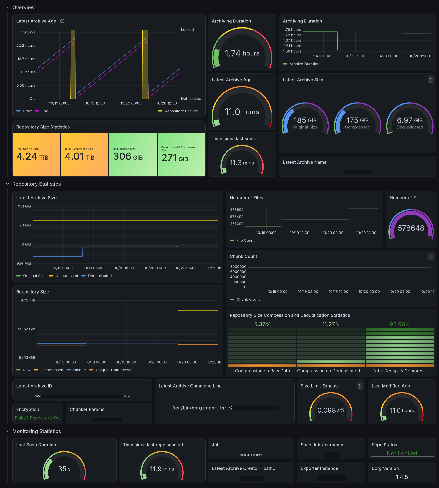

# prometheus-borg-exporter

a simple borg backup exporter for prometheus.

## Install

Per-Release tags are available at `docker-registry.timtrense.com/tim/prometheus-borg-exporter`.
See [the example docker compose.yaml](./src/test/docker/compose.yaml).
The source code is mirrored from [my gitlab](https://gitlab.timtrense.com/tim/prometheus-borg-exporter) to [GitHub](https://github.com/trensetim/prometheus-borg-exporter).

## Exported metrics

| metric name                                              | type  | description                                                                                                                                         |
| -------------------------------------------------------- | ----- | --------------------------------------------------------------------------------------------------------------------------------------------------- |
| borg_repository_successful_scan_timestamp_seconds        | gauge | UNIX timestamp of the last successful scan of the repository                                                                                        |
| borg_repository_scan_timestamp_seconds                   | gauge | UNIX timestamp of the last scan of the repository, successful or not                                                                                |
| borg_repository_scan_returncode                          | gauge | Return code (exitcode) of the borg info subprocess used for scanning the repository. Zero if successfully scanned.                                  |
| borg_repository_scan_info                                | gauge | Information about the last scan of the repository. Even if scan failed.                                                                             |
| borg_repository_locked                                   | gauge | Whether the repository is currently locked (1=yes, 0=no)                                                                                            |
| borg_repository_flocked                                  | gauge | Whether the repository is currently locked by an external flock (1=yes, 0=no)                                                                       |
| borg_repository_chunks_count                             | gauge | Number of chunks                                                                                                                                    |
| borg_repository_compressed_size_bytes                    | gauge | Total compressed and encrypted size of all chunks multiplied with their reference counts in bytes                                                   |
| borg_repository_size_bytes                               | gauge | Total uncompressed size of all chunks multiplied with their reference counts                                                                        |
| borg_repository_unique_chunks_count                      | gauge | Number of unique chunks                                                                                                                             |
| borg_repository_unique_compressed_size_bytes             | gauge | Compressed and encrypted size of all chunks in bytes                                                                                                |
| borg_repository_unique_size_bytes                        | gauge | Uncompressed size of all chunks                                                                                                                     |
| borg_repository_last_modified_timestamp_seconds          | gauge | Last modified UNIX timestamp                                                                                                                        |
| borg_repository_encryption_mode                          | enum  | Encryption mode of the repository: 'none', 'repokey', 'keyfile', 'authenticated', 'keyfile-blake2', 'repokey-blake2', 'authenticated-blake2'        |
| borg_repository_latest_archive_info                      | info  | Information about the latest/last archive/backup stored in the repository: {id,name,comment,hostname,command_line,chunker_params,username,hostname} |
| borg_repository_latest_archive_duration_seconds          | gauge | Seconds it took to create the latest archive                                                                                                        |
| borg_repository_latest_archive_start_timestamp_seconds   | gauge | UNIX timestamp when the creation of the latest archive was initiated                                                                                |
| borg_repository_latest_archive_end_timestamp_seconds     | gauge | UNIX timestamp when the creation of the latest archive was completed                                                                                |
| borg_repository_latest_archive_compressed_size_bytes     | gauge | Size after compression in bytes                                                                                                                     |
| borg_repository_latest_archive_deduplicated_size_bytes   | gauge | Deduplicated size (against the current repository, not when the archive was created) in bytes                                                       |
| borg_repository_latest_archive_nfiles_count              | gauge | Number of regular files in the archive                                                                                                              |
| borg_repository_latest_archive_original_size_bytes       | gauge | Size of files and metadata before compression in bytes                                                                                              |
| borg_repository_latest_archive_limits_archive_size_ratio | gauge | Float between 0 and 1 describing how large this archive is relative to the maximum size allowed by Borg                                             |

All metrics come with the labels `repository_name` with the name (aka path) of the repository.
All metrics (except possible non-successful-scan metrics `borg_repository_scan_timestamp_seconds`, `scan_returncode`, `borg_repository_scan_info`, `borg_repository_locked`, `borg_repository_flocked`) come with the label `repository_id` too.

## Configuration

The configuration is done by environment variables for simple cases (only one repository).
For boolean configuration options, the values are case-sensitive, python-style `True` or `False`!

| environmental variable                         | default                              | description                                                                                                                                                                                           |
| ---------------------------------------------- | ------------------------------------ | ----------------------------------------------------------------------------------------------------------------------------------------------------------------------------------------------------- |
| PROMETHEUS_EXPORTER_HTTP_PORT                  | 9401                                 | HTTP port number of the prometheus exporter                                                                                                                                                           |
| PROMETHEUS_EXPORTER_SCAN_INTERVAL_SECONDS      | 1800                                 | How often to run `borg info` on the repository, default is 30 minutes                                                                                                                                 |
| PROMETHEUS_EXPORTER_ALLOW_INITIAL_SCAN_FAILURE | `False`                              | set to `True` if you want to allow the initial repository scan to fail (maybe if the repo is expected to possibly be locked on startup)                                                               |
| PROMETHEUS_EXPORTER_EXIT_ON_FAILURE            | `False`                              | set to `True` if you want the exporter to exit on any failure (except `repository is locked`) AFTER the initial scan                                                                                  |
| PROMETHEUS_EXPORTER_CONFIG_FILE                | `/etc/borg/exporter-config.json`     | Where to mount the config file to                                                                                                                                                                     |
| PROMETHEUS_EXPORTER_DEBUG                      | `False`                              | set to `True` if you want more logging                                                                                                                                                                |
| BORG_REPOSITORY_PATH                           | `/var/lib/borg/repositories/default` | The path to the repository                                                                                                                                                                            |
| BORG_REPOSITORY_PASSPHRASE_FILE                | `/etc/borg/passphrases/default`      | The path to the repository                                                                                                                                                                            |
| BORG_REPOSITORY_NAME                           | `null`                               | If set, becomes the `repository_name` label in the exported metrics. Defaults to `BORG_REPOSITORY_PATH`                                                                                               |
| BORG_REPOSITORY_LOCKING                        | `acquire`                            | See [locking](#locking)                                                                                                                                                                               |
| BORG_REPOSITORY_LOCKING_TIMEOUT_SECONDS        | `0`                                  | See [locking](#locking)                                                                                                                                                                               |
| BORG_REPOSITORY_FLOCK_ENABLED                  | `False`                              | Set to `True` to acquire and hold a shared `flock` (`LOCK_SH`) on `BORG_REPOSITORY_FLOCK_FILE` during each repository scan (e.g. to coordinate with an external `rsync` holding an exclusive `flock`) |
| BORG_REPOSITORY_FLOCK_FILE                     | `/var/lock/borg/default`             | Path to the `flock` lock file when `BORG_REPOSITORY_FLOCK_ENABLED=True` (created if missing; read-only mounts of an existing lock file are also supported)                                            |
| BORG_REPOSITORY_FLOCK_TIMEOUT_SECONDS          | `1.0`                                | Seconds to wait for the shared `flock` before skipping the scan, setting `borg_repository_flocked=1`, and leaving scan metrics untouched (`0` skips immediately)                                      |
| BORG_REPOSITORY_FLOCK_BACKOFFS                 | `0.01,0.05,0.1,0.25,1.0,10.0`        | Backoff intervals between trying to acquire the `flock`. Comma-separated list of floats (seconds). Can also be a json-array of floats in the `config.json`.                                           |
| BORG_RSH                                       | unset                                |                                                                                                                                                                                                       |
| BORG_RELOCATED_REPO_ACCESS_IS_OK               | `True`                               |                                                                                                                                                                                                       |
| BORG_UNKNOWN_UNENCRYPTED_REPO_ACCESS_IS_OK     | `True`                               |                                                                                                                                                                                                       |

All environment variables like `BORG_*` will be proxied through to the borg CLI.
See [the borg documentation](https://borgbackup.readthedocs.io/en/stable/usage/general.html) for any env variable you may want to set.
Some of those are defined by this exporter already (but can get overwritten). See the above table for details.

## Configuration for multiple repositories

If you need to scan multiple repositories simultaneously, you must override the [/etc/borg/exporter-config.json](src/main/resources/config.json).
In there, you can define the `.repositories.your_repo_name = {path, passphrase_file, locking, flock_enabled, flock_file, flock_timeout_seconds}` accordingly (`flock_*` fields are optional and default to disabled).
You can use the above-described environment variables as placeholders (but no other ones), using `envsubst`-notation.

## Locking

There are 2 locking mechanisms supported.

### Borg Builtin Locks

The exporter can handle borgs builtin repository locks in 3 different ways.

- `bypass`: Unconditionally append [--bypass-lock](https://borgbackup.readthedocs.io/en/stable/usage/general.html#common-options) command line argument to borg cli commands.
- `acquire`: Do not append `--bypass-lock` (default). Lets borg cli acquire a shared read lock during it's operations.
- `respect`: Appends `--bypass-lock` to borg cli commands, but, before that, examines the repository file structure to discover existing **exclusive borg locks**. If any are found, the repository is considered "locked" and no scan is even attempted. (Only tested on borg v1 so far). If `BORG_REPOSITORY_LOCKING_TIMEOUT_SECONDS` is set (ie. not zero), overly old `lock.exclusive` directory-locks are ignored (eg. if you deal with a "no-delete" rsync'ed replica of a repository, where locks are kept dangling. In that case, you are on best-luck about whether your timeout exceeds any actual write operation on the repo), but an.

These modes facilitate using the exporter, when having the repository mounted as read-only, or when having the repository mounted from a remote (where borg's process PID liveness checks yield incorrect results), or when dealing with an rsync'ed copy of a repository (where concurrent operations must not be disturbed by acquiring local locks that do not propagate to the primary copy).

Note that the `borg_repository_locked` metric **does not** yield timestamps about when any particular lock was acquired/released, but only tells when the exporter detected the lock.

### Flocks

When coordinating with an external process (such as `flock /path/to/repo.lock rsync ...`), mount the lock file (or its parent directory) into the container at `/var/lock/borg/default` (or set `BORG_REPOSITORY_FLOCK_FILE`) and set `BORG_REPOSITORY_FLOCK_ENABLED=True`.
The lock file must be stable: it must not be deleted or replaced while in use, because `flock` **locks the files inode itself**, not its path.

## Hints

When accessing a remote repository via `ssh` in a running docker container, you probably want to mount your `id_rsa` and `known_hosts` to within `/home/prometheus-borg-exporter/.ssh`.

## Authors and acknowledgment

Special thanks to [this repository and its author](https://code.recycled.cloud/RecycledCloud/prometheus-borgbackup-exporter) for laying the groundwork.
